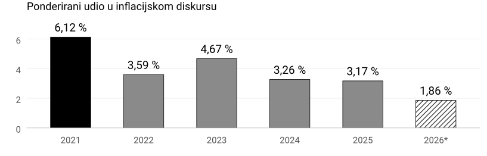
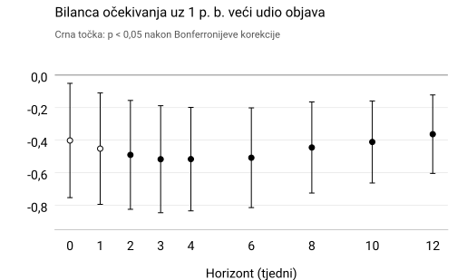
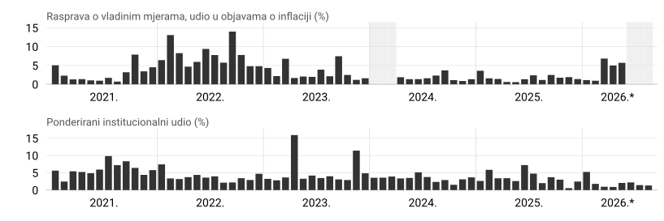

```{=typst}
// Isti Roboto, papir, tinta i tanke linije kao u konferencijskoj prezentaciji.
#set document(
  title: "Kada inflacija istisne glas središnje banke — sažeti prikaz istraživanja",
  author: ("Petra Palić", "Luka Sikić"),
)
#set text(font: "Roboto", size: 10.25pt, weight: "regular", fill: black, hyphenate: false)
#set par(justify: false, leading: 0.64em, spacing: 0.9em, first-line-indent: 0pt)

#set page(
  numbering: none,
  header: context if counter(page).get().at(0) > 1 [
    #set text(size: 7pt, weight: 500, tracking: 0.06em, fill: rgb("#555555"))
    #grid(columns: (1fr, auto),
      [KADA INFLACIJA ISTISNE GLAS SREDIŠNJE BANKE],
      [SAŽETI PRIKAZ ISTRAŽIVANJA],
    )
    #v(5pt)
    #line(length: 100%, stroke: 0.4pt + rgb("#d9d9d9"))
  ],
  footer: context [
    #line(length: 100%, stroke: 0.4pt + rgb("#d9d9d9"))
    #v(6pt)
    #set text(size: 7.2pt, weight: 500, tracking: 0.1em, fill: rgb("#555555"))
    #grid(columns: (1fr, auto),
      [PALIĆ · SIKIĆ],
      [#counter(page).display("01") / #numbering("01", counter(page).final().at(0))],
    )
  ],
)

#show heading: it => block(width: 100%, above: 1.4em, below: 0.7em, sticky: true)[
  #line(length: 100%, stroke: 0.4pt + black)
  #v(0.55em, weak: true)
  #text(size: 8pt, weight: 700, tracking: 0.13em)[#upper(it.body)]
]

#set figure(gap: 0.6em)
#show figure: set block(width: 100%, above: 1.1em, below: 1.1em)
#show figure.caption: it => align(left)[
  #set par(leading: 0.45em)
  #text(size: 8.3pt, weight: "regular", fill: rgb("#555555"))[#it.body]
]

#block(width: 100%, below: 1.8em)[
  #line(length: 100%, stroke: 0.5pt + black)
  #v(0.6em)
  #text(size: 7.6pt, weight: 700, tracking: 0.16em)[EKONOMSKI SUSRETI 2026]
  #v(1.5em)
  #block(width: 100%)[
    #set par(leading: 0.32em)
    #text(size: 31pt, weight: 300, tracking: -0.31pt)[
      Kada inflacija istisne#linebreak()glas središnje banke
    ]
  ]
  #v(0.9em)
  #text(size: 10.8pt, weight: 300)[
    Sažeti prikaz istraživanja o institucionalnom jazu u pažnji
  ]
  #v(1.2em)
  #text(size: 9pt, weight: 500)[Petra Palić · Luka Sikić]
  #linebreak()
  #text(size: 8.5pt, fill: rgb("#555555"))[Hrvatsko katoličko sveučilište]
]

```

## Više objava, manji dio rasprave

Institucija može biti prisutna u više objava, a zauzimati manji dio razgovora o inflaciji. U 2021. zabilježeno je 8.419 relevantnih institucionalnih objava, a u 2025. njih 10.151. Ponderirani udio u raspravi o cijenama istodobno je pao sa 6,12 % na 3,17 %. U prvih osam mjeseci 2026. iznosi 1,86 %. Putanja uključuje djelomičan oporavak 2023., pa ne govorimo o neprekidnom padu.

Poruka središnje banke mora biti dostupna da bi je javnost mogla uzeti u obzir. Ovaj rad mjeri mjesto institucije u medijskom prostoru. Ne mjeri tko je pojedinu poruku pročitao, razumio ili upotrijebio pri oblikovanju očekivanja. Potencijalni doseg objave nije stvarna čitanost.

## Tri istraživačka pitanja

Kako se institucionalni udio mijenja kroz vrijeme? Je li viša inflacija povezana s većim jazom u pažnji? Pomaže li učestalost objava predvidjeti očekivanja kućanstava? Na prvo pitanje odgovaraju deskriptivni podaci od siječnja 2021. do kolovoza 2026. Procjene odnosa i prediktivne veze odnose se na kraći uzorak od 2021. do 2023.

## Kako se mjeri zastupljenost

Ponderirani udio uspoređuje institucionalni doseg s ukupnim dosegom inflacijskog diskursa. Veću težinu dobiva objava s većim potencijalnim dosegom i istaknutijom ulogom institucije. Nazivniku se dodaje jedan radi stabilizacije. Udio može pasti i kada relevantnih objava ima više, ako ostatak rasprave raste brže.

Institucionalni jaz u pažnji jednak je prosječnom udjelu iz prve polovice 2021. umanjenom za udio u promatranom razdoblju. Pozitivan jaz znači nižu zastupljenost od početne reference. Ta referenca služi usporedbi i nije optimalan cilj komunikacije. Učestalost objava i potencijalni doseg pojedine objave prate se zasebno.

```{=typst}
#pagebreak()
```

## Podaci i dulja putanja

Deskriptivni prikaz obuhvaća 68 potpunih mjeseci, od siječnja 2021. do kolovoza 2026. U tom je prozoru 124.163 institucionalne objave, od kojih je 65.530 relevantno za inflacijski diskurs. Korpus o inflaciji sadrži 480.221 objavu. Institucionalni korpus uključuje HNB i generičke izraze za središnje banke te dio društvenih objava i komentara. Ne predstavlja samo izričita spominjanja HNB-a ni vlastita priopćenja banke.

Godišnji pregled pokazuje pad udjela 2022., djelomičan oporavak 2023. i ponovno niže vrijednosti u kasnijim godinama. Godišnji udjeli računaju se iz zbrojeva brojnika i nazivnika, a ne kao prosjek mjesečnih postotaka. Godina 2026. obuhvaća osam mjeseci i nije preračunata na cijelu godinu.

{width=100%}

## Širi medijski kontekst

Zaseban, uži skup sadrži 33.235 objava koje izričito spominju HNB u 281 izvoru. Riječi o cijenama i inflaciji pojavljuju se u približno trećini tih objava. Češće su riječi o kreditima i potrošačima, euru te plaćanjima i gotovini. Područja se preklapaju i temelje na popisima riječi bez neovisne provjere. Pokazuju prisutnost riječi, a ne glavnu temu objave. Taj se skup ne zbraja s institucionalnim korpusom.

Mjesečni grafikoni u prezentaciji odvojeno prikazuju godišnju stopu HICP inflacije, ponderirani udio, broj relevantnih objava, relativnu učestalost i omjer potencijalnog dosega. Povremeni skokovi i različite putanje pokazuju zašto broj objava i relativni prostor treba pratiti zajedno.

```{=typst}
#pagebreak()
```

## Inflacija i jaz u pažnji

Ekonometrijske procjene odnose se na 2021. do 2023., uz 36 mjesečnih i 157 tjednih opažanja u osnovnim modelima. Inflacija dolazi iz Eurostata, a očekivanja kućanstava iz Ankete Europske komisije o potrošačima. Modeli uključuju kontrole i Newey–West standardne pogreške.

U tjednom modelu s kontrolom obujma jedan postotni bod više inflacije povezan je s 0,00213 jedinica većim jazom, zaokruženo 0,0021. Vrijednost p iznosi 0,0002. To je uvjetna povezanost. Skok inflacije s 2 % na 10 % odgovara približno 12,9 % opaženog raspona jaza, bez tumačenja te razlike kao učinka intervencije.

Mjesečni modeli daju jasniji nalaz za relativnu učestalost. Jedan postotni bod više inflacije povezan je s približno 0,47 postotnih bodova manjim udjelom relevantnih objava, uz p = 0,0124. Za doseg po objavi nema statistički jasne veze, uz p = 0,3457. Margine opisuju različite ishode, a njihov umnožak nije točna računovodstvena dekompozicija.

## Učestalost i buduća očekivanja

Lokalne projekcije ispituju pomaže li učestalost predvidjeti kasnija očekivanja. Veći udio relevantnih objava povezan je s nižom budućom bilancom očekivanja cijena. Graf prikazuje procjenu za jedan postotni bod veći udio objava.

{width=90%}

Uz linearno mapiranje značajni su testirani horizonti 2, 3, 4, 6, 8, 10 i 12 tjedana. Uz stepenasto mapiranje 10. i 12. tjedan ne prolaze korekciju za višestruko testiranje. Nalaz je prediktivan i ovisi o mapiranju i uzorku. Ne identificira uzročni učinak medijske izloženosti.

```{=typst}
#pagebreak()
```

## Vlastita komunikacija i vladine mjere

Zabilježene vlastite objave HNB-a rastu s približno 23 mjesečno u 2021. na 35 u 2022. Riječ je o stavkama koje je zabilježio sustav praćenja, a ne potpunom popisu službenih dokumenata. Nalazi ne podupiru objašnjenje jednostavnim smanjenjem komunikacije banke.

Udio rasprave o vladinim mjerama raste s prosječnih 2,8 % u 2021. na 7,7 % u 2022., a u 2023. iznosi 3,1 %. Uključuje rasprave o zamrzavanju cijena, subvencijama energenata i paketima mjera. Graf uspoređuje smjer dvaju nizova koji imaju zasebne ljestvice i različito su izvedeni.

{width=100%}

Ovaj prikaz ne dokazuje da je jedna rasprava istisnula drugu. U regresijskoj provjeri koja uključuje vladinu komunikaciju tjedni koeficijent inflacije manji je približno za trećinu. To upozorava na važnost drugih sadržaja koji se natječu za isti tematski prostor.

## Promjena odnosa oko uvođenja eura

Chowov test pokazuje promjenu odnosa oko siječnja 2023., uz F = 9,43 i p < 0,001. Inflacija je nakon tog datuma slabiji prediktor jaza, a koeficijent sentimenta približno 3,3 puta snažniji. Promjena odnosa nije dokaz da ju je uzrokovalo samo uvođenje eura. Veća važnost domaćih objašnjenja cijena u europodručju moguća je institucionalna interpretacija.

```{=typst}
#pagebreak()
```

## Provjere i ograničenja

Provjere instrumentalnim varijablama koriste eurozonsku hranu i energiju te daju sličan smjer koeficijenta. Uzročno tumačenje ovisi o pretpostavci da instrumenti ne djeluju drugim kanalima na jaz. Usporedba s HANFA-om ima ograničenu snagu testa. Dodatne specifikacije i permutacije podupiru tjedni rezultat, ali ne uklanjaju sva alternativna objašnjenja.

Deskriptivni niz seže do kolovoza 2026., dok procjene odnosa ostaju vezane uz 2021. do 2023. i jednu zemlju. Kasniji niži udjeli sami po sebi ne dokazuju trajan učinak inflacije ni učinak uvođenja eura. Potrebno je razdvojiti izričita spominjanja HNB-a od generičkih izraza za središnje banke i provjeriti doprinos promjena izvora i sastava korpusa.

Potencijalni doseg ne mjeri stvarnu izloženost ni razumijevanje publike. Klasifikator tona nije posebno provjeren na hrvatskim ekonomskim tekstovima. Mjesečna očekivanja prenose se na tjednu frekvenciju, a izbor mapiranja utječe na dulje prediktivne horizonte. Izvorna baza i podaci o pojedinim objavama nisu javno dostupni zbog uvjeta pristupa i sadržaja trećih strana, pa javni materijali ne omogućuju potpunu replikaciju.

## Što pratiti u komunikaciji

Broj vlastitih objava opisuje samo dio komunikacijskog puta. Uz priopćenja, analize i objašnjenja institucije treba pratiti koliko ih mediji prenose, koliki prostor zauzimaju i kakav sadržaj dolazi do publike. Zasebno treba mjeriti stvarnu izloženost, razumijevanje i korisnost poruke.

Glavni nalaz povezuje višu inflaciju s većim jazom i manjom relativnom učestalošću. Učestalost i potencijalni doseg imaju različite putanje. Veza s očekivanjima prediktivna je i osjetljiva na specifikaciju. Ti nalazi daju okvir za praćenje komunikacije, ali sami ne dokazuju uspješnost pojedine komunikacijske intervencije.

## Izvori i materijali

Prikaz je usklađen s 27 slajdova aktualne [konferencijske prezentacije](https://lusiki.github.io/Ekonomski-susreti/slides/). Deskriptiva koristi spremljene agregate izdanja rada od 28. rujna 2026. Ekonometrijski nalazi preuzeti su iz tablica 4, 6 i 7a izvornog rada, a širi kontekst iz zasebnih agregata dokumentiranih uz slajdove.

[Cjeloviti rad](https://lusiki.github.io/HNB_Media_Attention/media/downloads/PAPER_EXT.html) i [materijali izlaganja i radionice](https://lusiki.github.io/Ekonomski-susreti/) dostupni su na mreži. Predloženo citiranje glasi Palić, P. i Sikić, L. (2026). *Pasivno zamijenjena. Cijena inflacije koju ne mjeri indeks potrošačkih cijena*. Radni materijal, Hrvatsko katoličko sveučilište.

Stavovi izneseni u radu isključivo su stavovi autora i ne odražavaju nužno stavove Hrvatskog katoličkog sveučilišta.
