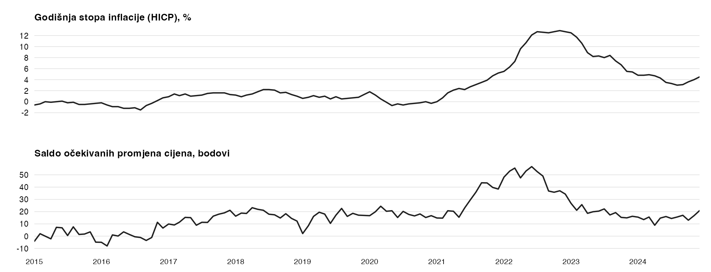

## Jedno pitanje za cijeli sat

> Kako su se inflacija i očekivanja kretali u Hrvatskoj od 2015. do 2024. i je li njihova povezanost ista u različitim razdobljima?

::: {.kartice}
::: {}
**0–23 min**

Pitanje, izvori i plan analize
:::
::: {}
**23–46 min**

Podaci, grafovi i zaključak
:::
::: {}
**46–60 min**

Positron, objava i rasprava
:::
:::

[Tablica za rad](https://lusiki.github.io/Ekonomski-susreti/workshop/data/croatia_inflation.csv) · [Upiti za kopiranje](https://lusiki.github.io/Ekonomski-susreti/workshop/upiti.html)

## 1.1 · Postavite istraživačko pitanje

::: {.tiho}
3.–8. minuta · Razgovor
:::

> Što sve možemo pitati kad imamo samo dvije mjesečne serije za Hrvatsku?

**Od teme do pitanja**

Usporedba godišnjih prosjeka odgovara na pitanje koliko su se mjere promijenile. Mjesečni graf pokazuje kada se promjena dogodila.

::: {.notes}
Uz prvi graf napišite jednu jasnu rečenicu. Ako vam to ide sporije od izrade grafa, zastanite i razjasnite što nije jasno.
:::

## Isprobajte · Postavite istraživačko pitanje

Odaberite jedno od tri pitanja koja vam predloži alat. Koji bi vam prikaz pomogao odgovoriti na njega?

::: {.file-links}
[Otvorite upit 1.1](https://lusiki.github.io/Ekonomski-susreti/workshop/upiti.html#korak-1-1) · Vodič, str. 3
:::

::: {.notes}
Usporedba godišnjih prosjeka odgovara na pitanje koliko su se mjere promijenile. Mjesečni graf pokazuje kada se promjena dogodila.

Odaberite jedno od tri pitanja koja vam predloži alat. Koji bi vam prikaz pomogao odgovoriti na njega?

Uz prvi graf napišite jednu jasnu rečenicu. Ako vam to ide sporije od izrade grafa, zastanite i razjasnite što nije jasno.
:::

## 1.2 · Pronađite i provjerite izvore

::: {.tiho}
8.–13. minuta · Razgovor
:::

> Mijenja li definicija mjere ono što smijemo zaključiti kad uspoređujemo inflaciju i očekivanja?

**Jedan mjesec, dva vremenska horizonta**

Stopa inflacije za ožujak 2022. uspoređuje cijene s ožujkom 2021. Ispitanici u ožujku 2022. procjenjuju kretanje cijena tijekom sljedećih dvanaest mjeseci.

::: {.notes}
Saldo nije postotak. Prije svake usporedbe pročitajte službenu definiciju obiju mjera.
:::

## Isprobajte · Pronađite i provjerite izvore

[Eurostat · HICP](https://ec.europa.eu/eurostat/web/hicp/information-data) · [DG ECFIN · metodologija](https://economy-finance.ec.europa.eu/economic-forecast-and-surveys/business-and-consumer-surveys/methodology-business-and-consumer-surveys/methodological-concepts_en)

Otvorite obje metodologije. Koje biste jedinice napisali uz osi grafikona?

::: {.file-links}
[Otvorite upit 1.2](https://lusiki.github.io/Ekonomski-susreti/workshop/upiti.html#korak-1-2) · Vodič, str. 4
:::

::: {.notes}
Stopa inflacije za ožujak 2022. uspoređuje cijene s ožujkom 2021. Ispitanici u ožujku 2022. procjenjuju kretanje cijena tijekom sljedećih dvanaest mjeseci.

Otvorite obje metodologije. Koje biste jedinice napisali uz osi grafikona?

Saldo nije postotak. Prije svake usporedbe pročitajte službenu definiciju obiju mjera.
:::

## 1.3 · Provjerite i uredite sažetak

::: {.tiho}
13.–19. minuta · Razgovor
:::

> Gdje se u kraćenju teksta izgubi ili promijeni značenje nalaza?

**Četiri pogreške u jednoj tvrdnji**

„Anketa je obuhvatila 120 hrvatskih kućanstava, koja su 2022. u prosjeku očekivala inflaciju od 46,62 %. Korelacija od oko 0,70 dokazuje da su točno predvidjeli buduće cijene. Tako je bilo u svakom razdoblju.“

::: {.notes}
Uz glavni nalaz uvijek napišite i ono što iz njega još ne znamo.
:::

## Isprobajte · Provjerite i uredite sažetak

Provjerite četiri mjesta: jedinicu promatranja, mjernu jedinicu, vremenski odnos i izbor razdoblja.

::: {.file-links}
[Otvorite upit 1.3](https://lusiki.github.io/Ekonomski-susreti/workshop/upiti.html#korak-1-3) · Vodič, str. 5
:::

::: {.notes}
„Anketa je obuhvatila 120 hrvatskih kućanstava, koja su 2022. u prosjeku očekivala inflaciju od 46,62 %. Korelacija od oko 0,70 dokazuje da su točno predvidjeli buduće cijene. Tako je bilo u svakom razdoblju.“

Provjerite četiri mjesta: jedinicu promatranja, mjernu jedinicu, vremenski odnos i izbor razdoblja.

Uz glavni nalaz uvijek napišite i ono što iz njega još ne znamo.
:::

## 1.4 · Pripremite plan analize

::: {.tiho}
19.–23. minuta · Razgovor
:::

> Koji nam prikaz i koja usporedba trebaju da bismo odgovorili baš na svoje pitanje?

**Plan prije prvog izračuna**

Provjerite mjesece i jedinice. Nacrtajte dvije serije. Izračunajte godišnje prosjeke. Usporedite korelacije u dva razdoblja. Objasnite što iz njih možete zaključiti.

::: {.notes}
Prije izračuna morate moći reći čemu svaki korak služi.
:::

## Isprobajte · Pripremite plan analize

Jedan korak zadržite, a jedan promijenite. Objasnite kako izmjena pomaže odgovoriti na pitanje.

::: {.file-links}
[Otvorite upit 1.4](https://lusiki.github.io/Ekonomski-susreti/workshop/upiti.html#korak-1-4) · Vodič, str. 6
:::

::: {.notes}
Provjerite mjesece i jedinice. Nacrtajte dvije serije. Izračunajte godišnje prosjeke. Usporedite korelacije u dva razdoblja. Objasnite što iz njih možete zaključiti.

Jedan korak zadržite, a jedan promijenite. Objasnite kako izmjena pomaže odgovoriti na pitanje.

Prije izračuna morate moći reći čemu svaki korak služi.
:::

## 2.1 · Upoznajte i provjerite podatke

::: {.tiho}
23.–28. minuta · Razgovor
:::

> Što je jedan redak u našoj tablici i što nam govore dva broja u njemu?

**Što predstavlja prvi redak?**

U siječnju 2015. godišnja stopa inflacije iznosi −0,6 %, a saldo očekivanja −4,2 boda. U zadnjem mjesecu, prosincu 2024., vrijednosti su 4,5 % i 20,8 bodova.

::: {.notes}
Prije zadatka predvidite dio rezultata. Ako se rezultat razlikuje od očekivanja, tražite objašnjenje prije nastavka.
:::

## Isprobajte · Upoznajte i provjerite podatke

| Mjesec | HICP (%) | Saldo (bodovi) |
|:---|---:|---:|
| Siječanj 2015. | −0,6 | −4,2 |
| Prosinac 2024. | 4,5 | 20,8 |

Zatražite prva i zadnja tri retka. Postoji li točno jedan redak za svaki od 120 mjeseci?

::: {.file-links}
[Otvorite upit 2.1](https://lusiki.github.io/Ekonomski-susreti/workshop/upiti.html#korak-2-1) · Vodič, str. 7
:::

::: {.notes}
U siječnju 2015. godišnja stopa inflacije iznosi −0,6 %, a saldo očekivanja −4,2 boda. U zadnjem mjesecu, prosincu 2024., vrijednosti su 4,5 % i 20,8 bodova.

Zatražite prva i zadnja tri retka. Postoji li točno jedan redak za svaki od 120 mjeseci?

Prije zadatka predvidite dio rezultata. Ako se rezultat razlikuje od očekivanja, tražite objašnjenje prije nastavka.
:::

## 2.2 · Izradite i objasnite prikaze

::: {.tiho}
28.–35. minuta · Razgovor
:::

> Kako nacrtati postotke i bodove tako da im se kretanje ipak može usporediti?

Na papiru skicirajte kako biste smjestili dvije mjere s različitim jedinicama na zajedničku vremensku os.

::: {.notes}
Graf najprije pogledajte sami, a tek onda čitajte opis koji je napisao alat.
:::

## Dva prikaza, zajednička os mjeseci

{width=900 fig-alt="Mjesečne serije za Hrvatsku, 2015.–2024."}

::: {.file-links}
[Otvorite upit 2.2](https://lusiki.github.io/Ekonomski-susreti/workshop/upiti.html#korak-2-2) · Vodič, str. 8–9 · Hrvatska, 120 mjeseci · Izvori: Eurostat i DG ECFIN
:::

::: {.notes}
Saldo doseže 56,7 bodova u lipnju 2022., a inflacija 12,9 % u studenom. U prosincu je saldo već pao na 34,3 boda dok je godišnja stopa inflacije još 12,7 %.

Prikažite samo 2020.–2024. Što u užem razdoblju lakše uočavate? Što je nestalo iz prikaza?

Graf najprije pogledajte sami, a tek onda čitajte opis koji je napisao alat.
:::

## Što godišnji prosjek skriva?

| Godina | Inflacija, prosjek mjesečnih godišnjih stopa | Saldo, godišnji prosjek |
|:---|---:|---:|
| 2021. | 2,68 % | 28,26 bodova |
| 2022. | 10,63 % | 46,62 boda |

Saldo doseže vrh u lipnju 2022., a inflacija u studenom. Godišnji prosjek sažima oba događaja u jedan redak.

::: {.file-links}
[Cijela tablica godišnjih prosjeka](https://lusiki.github.io/Ekonomski-susreti/workshop/nalaz.html)
:::

## 2.3 · Ponovite analizu od početka

::: {.tiho}
35.–41. minuta · Razgovor
:::

> Bi li naš opis odnosa bio isti da smo gledali neko drugo razdoblje?

**Isti podaci, tri korelacije**

Za 2022. zbroj dvanaest mjesečnih godišnjih stopa iznosi 127,6. Podijelite ga s 12 i usporedite dobivenih 10,63 % s godišnjom tablicom.

::: {.notes}
Ponovljen račun provjerava aritmetiku, a ne tumačenje.
:::

## Isprobajte · Ponovite analizu od početka

| Razdoblje | Mjeseci | Pearsonov r |
|:---|---:|---:|
| 2015.–2024. | 120 | 0,6985 |
| 2015.–2019. | 60 | 0,8279 |
| 2020.–2024. | 60 | 0,5342 |

Što se gubi kada svih deset godina sažmemo jednom korelacijom?

::: {.file-links}
[Otvorite upit 2.3](https://lusiki.github.io/Ekonomski-susreti/workshop/upiti.html#korak-2-3) · Vodič, str. 10
:::

::: {.notes}
Za 2022. zbroj dvanaest mjesečnih godišnjih stopa iznosi 127,6. Podijelite ga s 12 i usporedite dobivenih 10,63 % s godišnjom tablicom.

Što se gubi kada svih deset godina sažmemo jednom korelacijom?

Ponovljen račun provjerava aritmetiku, a ne tumačenje.
:::

## 2.4 · Napišite i uredite zaključak

::: {.tiho}
41.–46. minuta · Razgovor
:::

> Kako biste svoj nalaz objasnili kolegi koji nije vidio ni podatke ni razgovor s alatom?

**Prva verzija zaključka**

Od 2021. do 2022. prosjek mjesečnih godišnjih stopa porastao je s 2,68 % na 10,63 %. Prosječni saldo u istom je razdoblju porastao s 28,26 na 46,62 boda.

::: {.notes}
Najprije napišite vlastito tumačenje, makar bilo nespretno. Alat komentira, a vi prerađujete.
:::

## Isprobajte · Napišite i uredite zaključak

Napišite dvije rečenice o grafu. Zatražite komentar na argument i sami preradite rečenicu koju je čitatelj pogrešno razumio.

::: {.file-links}
[Otvorite upit 2.4](https://lusiki.github.io/Ekonomski-susreti/workshop/upiti.html#korak-2-4) · Vodič, str. 11
:::

::: {.notes}
Od 2021. do 2022. prosjek mjesečnih godišnjih stopa porastao je s 2,68 % na 10,63 %. Prosječni saldo u istom je razdoblju porastao s 28,26 na 46,62 boda.

Napišite dvije rečenice o grafu. Zatražite komentar na argument i sami preradite rečenicu koju je čitatelj pogrešno razumio.

Najprije napišite vlastito tumačenje, makar bilo nespretno. Alat komentira, a vi prerađujete.
:::

## 3.1 · Ponovite sve u Positronu

::: {.tiho}
46.–52. minuta · Razgovor
:::

> Što od ovog sata ostaje kad zatvorite prozor razgovora?

**Od tablice do dvije datoteke**

U praznoj mapi u Positronu otvorite asistenta. U mapu data spremite CSV. U index.qmd zajedno zapišite izračune, graf i zaključak. Naredbom quarto render index.qmd izradite HTML i PDF.

::: {.notes}
Svaki broj u tekstu dolazi iz koda, a cijela se analiza pokreće jednom naredbom.
:::

## Isprobajte · Ponovite sve u Positronu

`data/croatia_inflation.csv` → `index.qmd` → `index.html` i `index.pdf`

Pronađite redak koji računa korelaciju i provjeru koja zaustavlja izradu kad nedostaje mjesec.

::: {.file-links}
[Otvorite upit 3.1](https://lusiki.github.io/Ekonomski-susreti/workshop/upiti.html#korak-3-1) · Vodič, str. 12
:::

::: {.notes}
U praznoj mapi u Positronu otvorite asistenta. U mapu data spremite CSV. U index.qmd zajedno zapišite izračune, graf i zaključak. Naredbom quarto render index.qmd izradite HTML i PDF.

Pronađite redak koji računa korelaciju i provjeru koja zaustavlja izradu kad nedostaje mjesec.

Svaki broj u tekstu dolazi iz koda, a cijela se analiza pokreće jednom naredbom.
:::

## 3.2 · Objavite na GitHubu

::: {.tiho}
52.–56. minuta · Razgovor
:::

> Može li kolega dobiti vaš rezultat bez vas?

**Od lokalne mape do objave**

Otvorite prazan repozitorij. Pregledajte datoteke koje šaljete, potvrdite slanje pa u postavkama Pages odaberite granu main i korijensku mapu.

::: {.notes}
Objava je vaša odluka. Prije slanja pogledajte što šaljete.
:::

## Isprobajte · Objavite na GitHubu

[Gotov projekt za rad u Positronu](https://lusiki.github.io/Ekonomski-susreti/workshop/projekt.zip) · [Primjer objavljene analize](https://lusiki.github.io/Ekonomski-susreti/workshop/nalaz.html)

Otvorite objavljeni HTML i PDF. Može li kolega iz README-a saznati odakle dolaze podaci i kako ponoviti analizu?

::: {.file-links}
[Otvorite upit 3.2](https://lusiki.github.io/Ekonomski-susreti/workshop/upiti.html#korak-3-2) · Vodič, str. 13
:::

::: {.notes}
Otvorite prazan repozitorij. Pregledajte datoteke koje šaljete, potvrdite slanje pa u postavkama Pages odaberite granu main i korijensku mapu.

Otvorite objavljeni HTML i PDF. Može li kolega iz README-a saznati odakle dolaze podaci i kako ponoviti analizu?

Objava je vaša odluka. Prije slanja pogledajte što šaljete.
:::

## Završni razgovor

::: {.tiho}
56.–60. minuta
:::

> Biste li primijetili da je ovo pogrešno?

Što vam je alat olakšao? Oko koje ste odluke najviše razmišljali? Odaberite jednu provjeru koju ćete prenijeti u svoje istraživanje.

[Sažetak za sudionike](https://lusiki.github.io/Ekonomski-susreti/workshop/handout.html) · [Svi materijali radionice](https://lusiki.github.io/Ekonomski-susreti/workshop/)
